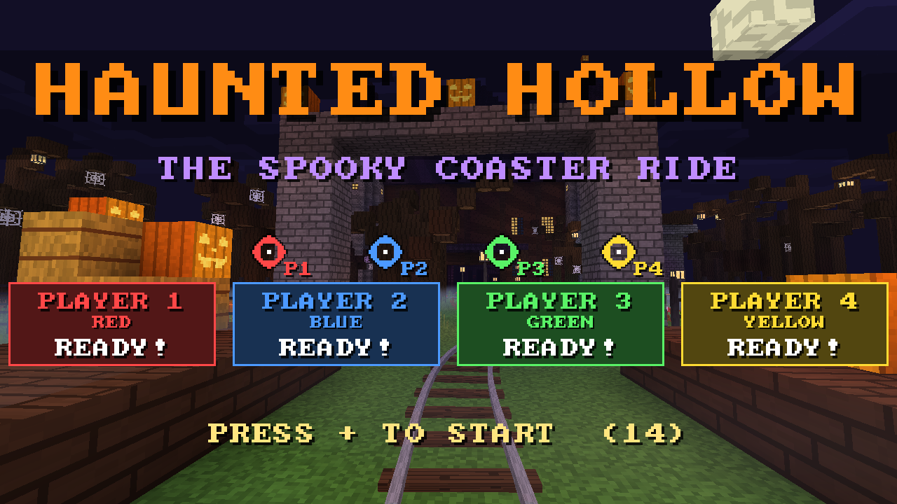
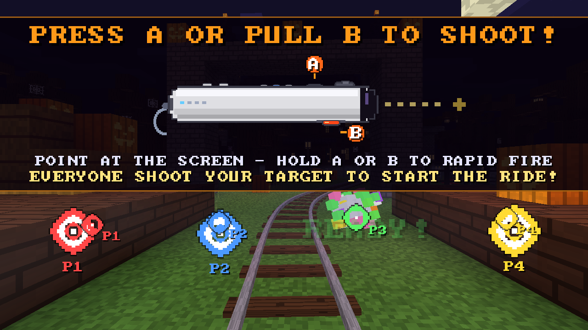
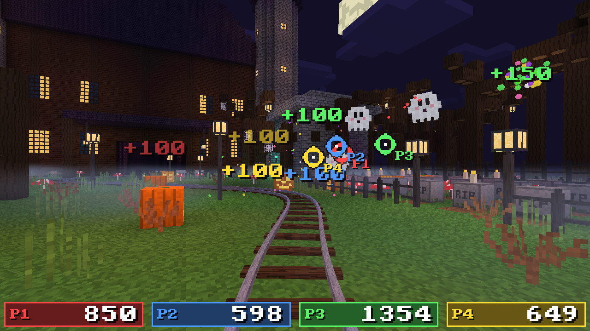
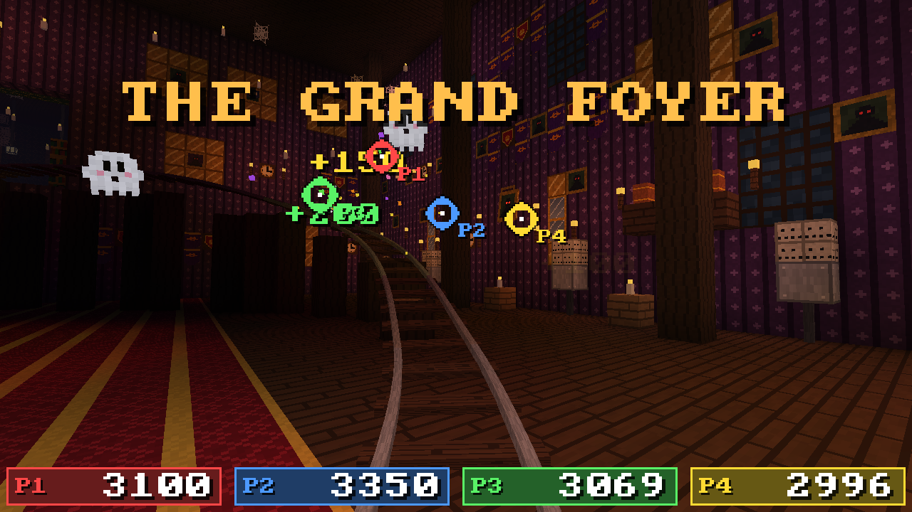
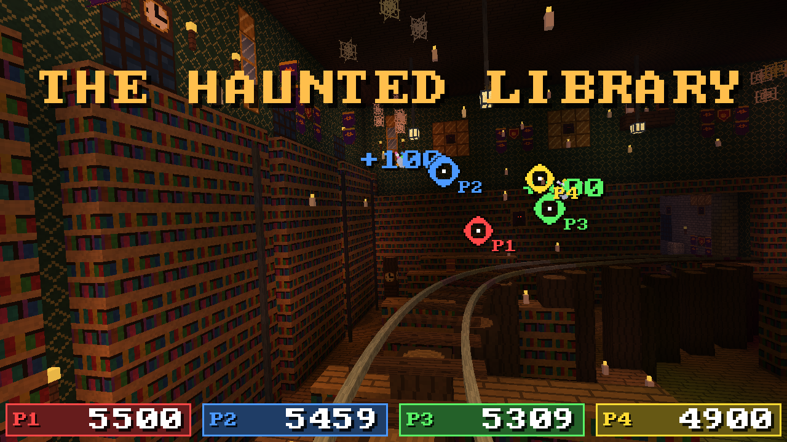
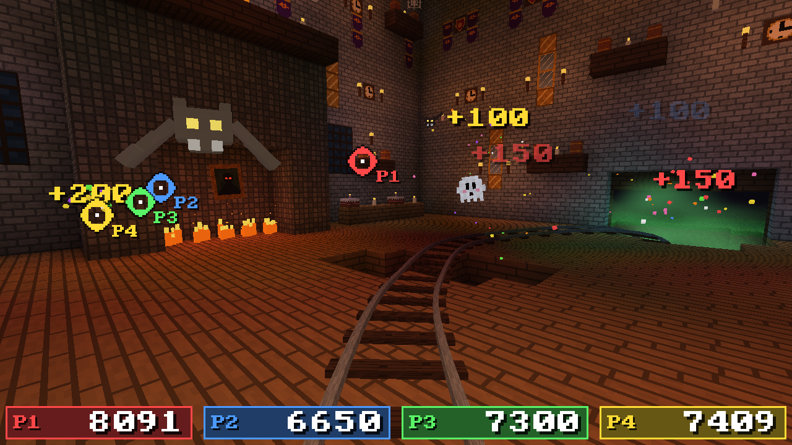
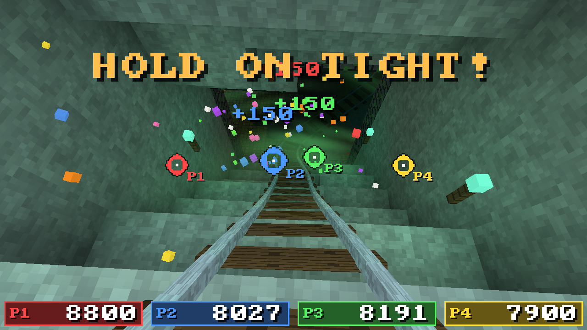
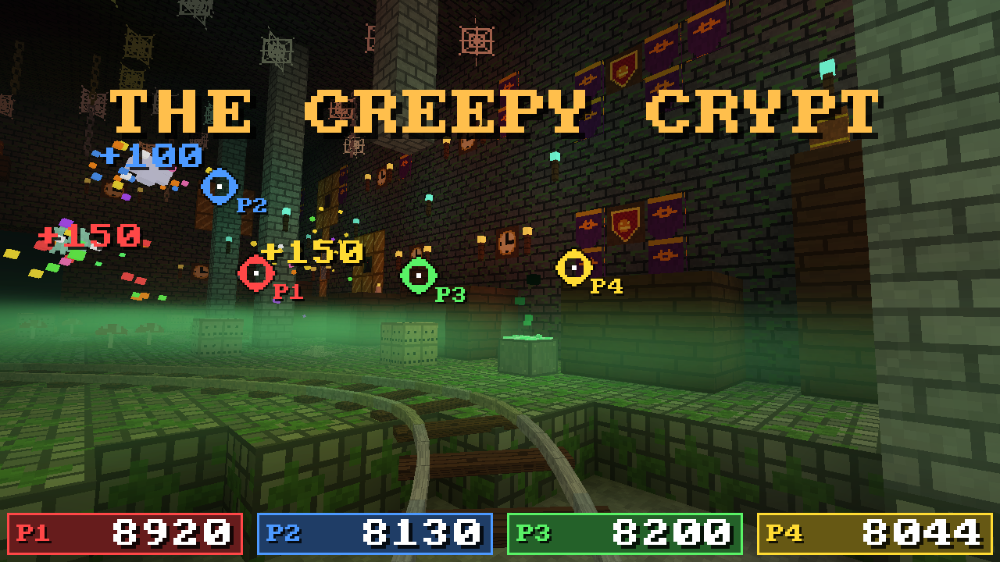
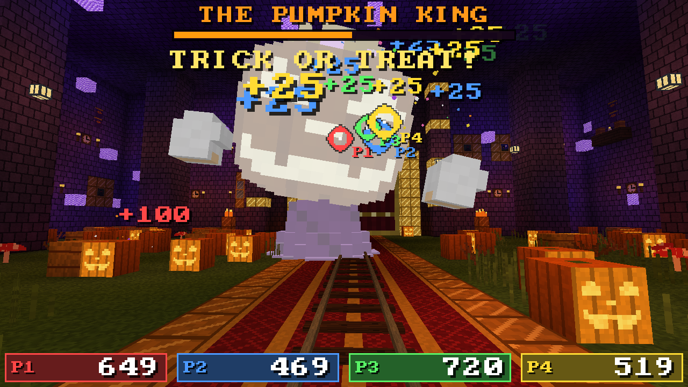
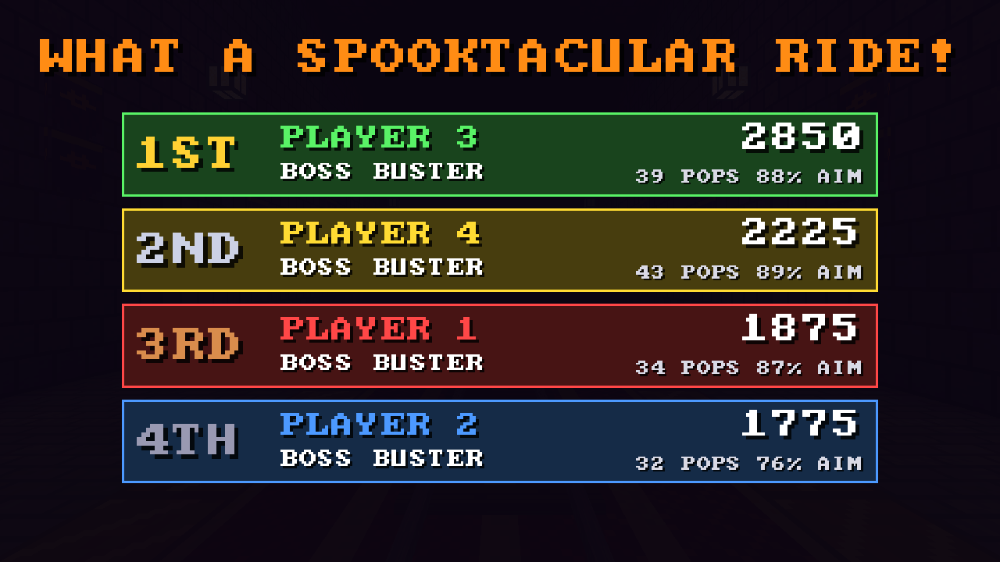

# Haunted Hollow 🎃

> **Note:** This game was made with the help of [Claude Opus 5.5](https://www.anthropic.com/claude),
> an AI model by Anthropic, working in Claude Code. The code, world, models, textures, music and
> sound effects were all written with Claude, under human direction.

A Halloween on-rails shooter for **1–4 players with Wii Remotes**, made for young kids and up.
Everyone rides a roller-coaster cart through a blocky haunted-house attraction — graveyard,
grand foyer, haunted library, dining hall, a big drop into the crypt — and pops ghosts, bats,
pumpkins, flying books, waving skeletons and dangling spiders into candy confetti. At the end
the **Pumpkin King** rises from his pumpkin patch in front of a pair of grand red-and-gold doors
and blocks the track until the riders beat him. Then the doors swing open and the ride rolls out
through them, down a lantern-lit hall that fades away into darkness, to the score screen.



| | |
|:---:|:---:|
|  |  |
| Everyone pops a practice target before the countdown | The graveyard |
|  |  |
| The grand foyer | The haunted library |
|  |  |
| The dining hall | The big drop |
|  |  |
| The creepy crypt | The Pumpkin King |
|  | |
| Scores and awards | |

Nobody can lose: there is no health and no game over, just a score per player and a fun
award on the results screen ("GHOST CATCHER", "BAT BOPPER", "BOSS BUSTER"...).

* Ride: exactly **120 seconds** from the station to the boss (the track's speed profile is
  normalised to that), then the boss fight lasts as long as it takes (~15–40 s depending on skill
  and player count; his health scales with the number of players).
* Each player has their own crosshair colour: **P1 red, P2 blue, P3 green, P4 yellow**.
* Kid-friendly aiming: generous hit areas with a minimum on-screen size, targets gently pulse.
* Rust + Vulkan (ash) + winit, Minecraft-style voxel world with procedural 16×16 textures,
  coloured flood-fill block lighting, smooth lighting/ambient occlusion and a rider's lantern.
  No asset files: all textures, models and the world are generated in code.
* Music and sound: original tunes (spooky theremin title, creepy music-box ride theme,
  brassy boss battle, victory fanfare, happy results theme) and ~20 effects, all synthesized in
  code at start-up. Sound goes out through ALSA, loaded at runtime (works with PipeWire /
  PulseAudio via their ALSA bridge). `--mute` turns it off, `HAUNTED_ALSA_DEVICE=hw:1,0`
  picks a different device, and `--dump-audio DIR` writes every track and effect as WAV files.
* Targets are only spawned where every rider can see and reach them: each spot is checked
  against the ride's predicted camera over the target's whole life. The whole body has to be in
  open air (never inside a wall, the floor or a prop), every edge has to be visible (nothing in
  the way), it can't overlap another target, and it must stay clear of the score panels and the
  boss bar. New targets are steered to different parts of the screen so they don't bunch up.

## Download

Prebuilt Linux (x86_64) builds are on the [Releases](https://github.com/alkazar/haunted-hollow/releases)
page. Grab `haunted-hollow-<version>-linux-x86_64.tar.gz`, unpack it and run `./haunted-hollow`.
You need a Vulkan driver (Mesa or NVIDIA).

To publish a new release, push a version tag: `git tag v1.0.0 && git push origin v1.0.0`.
The [release workflow](.github/workflows/release.yml) tests, builds and uploads it. The tag is
the version: the game shows it on the title screen and with `--version`. Local builds use
`git describe --tags` instead (e.g. `v1.0.0-3-gabc1234`, three commits after `v1.0.0`), so the
version in `Cargo.toml` doesn't need updating.

## Build & run

Requirements: Linux, a Rust toolchain (1.77+), a Vulkan driver (Mesa or NVIDIA).
Shaders are WGSL compiled to SPIR-V at build time by `naga`, so no `glslc` is needed.

```sh
cargo build --release
./target/release/haunted_hollow            # fullscreen, Wii Remotes
./target/release/haunted_hollow --debug    # windowed, play with the mouse
./target/release/haunted_hollow --help
```

## Playing with Wii Remotes

### Connecting Wii Remotes

You need Bluetooth, the remotes, and an IR sensor bar. There's nothing to pair or install: the
game finds and connects the remotes itself.

**1. Connect each remote**

With the game running, press **1** and **2** on the remote together. Its four LEDs blink while
it's looking for the game; when it connects all four light up steadily and it gives a short
buzz. Then press **A** to join, and only your player's LED stays lit. Connect up to four remotes this way, at any time (also mid-ride).
Remotes don't stay paired: after the game quits (or a remote turns off), press 1+2 again.

The game talks to the remotes directly over Bluetooth, so the `hid-wiimote` kernel driver,
udev rules and controller remappers like InputPlumber don't get involved. It only needs
BlueZ running and the adapter powered on (`bluetoothctl power on`).

**Or: use a Mayflash DolphinBar**

If a DolphinBar in **mode 4** is plugged in, the game uses it instead of the computer's
Bluetooth. The game checks for the bar when it starts, so plug it in before starting the game. Remotes sync with
the bar: press 1+2 (or SYNC) on a remote, the same as in Dolphin. The bar is also the sensor bar.
Press the bar's MODE button until the LED for mode 4 lights.
A remote joins as the player of the bar slot it's in: slot 1 is player 1, slot 2 is player 2, and so on,
whatever order people press A in. A remote that drops out during a game gets its player back when it
reconnects, even if the bar puts it in a different slot. The game recognizes each remote by the
accelerometer calibration stored in it at the factory.

The bar's four HID devices are root-only by default, so it needs a udev rule once:

```sh
echo 'KERNEL=="hidraw*", ATTRS{idVendor}=="057e", ATTRS{idProduct}=="0306", MODE="0660", TAG+="uaccess"' \
  | sudo tee /etc/udev/rules.d/60-dolphinbar.rules
sudo udevadm control --reload && sudo udevadm trigger
```

Without it the game logs `can't open the DolphinBar ... Permission denied`.

**2. Set up the sensor bar**

The remote aims by seeing two IR lights, so you need a **sensor bar**: a Wii console's bar (the
Wii must be switched on), or any USB- or battery-powered one. Put it centred above or below the
screen. Without it the buttons still work, but there's no crosshair.

**Troubleshooting**

* **Run with `--debug` and press F3.** The overlay shows how many remotes the game sees, how
  many reports per second each one sends and the raw IR dots it picks up. The terminal logs
  each remote connecting and disconnecting (`[wiimote] ...`). Remotes but no dots means the
  remote can't see the sensor bar.
* **A remote never connects.** If it was paired before (e.g. with `bluetoothctl`), BlueZ
  hands it to the kernel driver instead of the game, and the game logs
  `... is paired with BlueZ`. Unpair it once with `bluetoothctl remove XX:XX:XX:XX:XX:XX`.
  Also check that no other program (Dolphin, say) is connecting remotes at the same time.
* **The crosshair moves the wrong way or doesn't reach the edges.** See the pointer calibration
  flags below.

### Playing

Remotes are hot-plugged at any time. On the title screen each player presses **A** to join and
gets the next colour; anyone presses **+** to start (it also auto-starts 15 s after the first
join). Late arrivals can press A mid-ride to jump in. After the score screen everyone goes
back to the title and presses **A** again to play another round.

| Button | Action |
|---|---|
| B (trigger) or A | Shoot (hold for auto-fire) / join |
| + | Start the ride |
| HOME | Pause / resume |
| − (while paused) | Back to the title screen |

Remotes rumble when you pop something.

**High scores**: after the score screen, every rider whose score makes the top ten shoots the
letters of their initials (up to three) on a big letter grid, then **END** (**DEL** removes a
letter). Anyone who hasn't finished after 45 s keeps what they shot, or goes in as P1–P4. The
table is then shown before the title, and the best score is shown on the title screen. It's
saved in `~/.local/share/haunted-hollow/highscores.txt` (or under `$XDG_DATA_HOME`); delete
that file to reset it. Computer players (`--bots`) never enter the table.

**Pointer calibration** (if the crosshair moves the wrong way or doesn't reach the edges):
`--wii-flip-x`, `--wii-flip-y`, `--wii-gain 1.6`, `--wii-y-offset -0.1` (for a bar below the TV).
In `--debug` mode the overlay (F3) shows each remote's raw IR dots.

## Debug / mouse mode

`--debug` runs windowed with an info overlay and lets the mouse play:

| Input | Action |
|---|---|
| Mouse | Aim (player 1 by default) |
| Left click | Shoot / join |
| 1 – 4 | Make the mouse control that player (joins them) — test multiplayer scoring |
| Enter / Space / right click | Start |
| B | Skip straight to the boss |
| Tab (hold) | Fast-forward ×4 |
| P | Pause, Backspace while paused = title |
| F3 | Toggle debug overlay · F11 fullscreen · Esc quit |

Other handy flags: `--bots N` (computer players, an attract/demo mode), `--boss`,
`--timescale X`, `--size 1920x1080`, and `--shots 10,60 --exit-after 70` to save screenshots.

## VR mode

`--vr` plays the ride in a VR headset through OpenXR, for one rider with the headset's
controllers. Start an OpenXR runtime first (SteamVR, or Monado with `monado-service`), then
run `./target/release/haunted_hollow --vr`. It needs the OpenXR loader
(`libopenxr_loader.so.1`, Fedora package `openxr-libs`, Debian/Ubuntu `libopenxr-loader1`).

* The ride runs as on a TV. The cart's camera always faces forward and targets
  appear in front of it as usual. You can look around and lean to admire the scenery.
* You are always player 1, with nothing to join. The title screen has a START button:
  shoot it (or press A) and the ride starts, without the target-practice lesson. Only your
  own score is shown.
* The HUD floats on a virtual screen 9 m ahead. Score popups sit where the targets were
  hit; menus, banners and scores are drawn at half size in the middle (about 68x39 degrees)
  so you can read them without turning your head.
* The controller is a wand with a laser beam. The crosshair floats where the beam ends, on
  a sphere 9 m around you, facing you. Whichever hand last pulled its trigger does the aiming.

| Touch-style controllers (also Steam Frame) | Index | Action |
|---|---|---|
| Trigger | Trigger | Shoot |
| A / X | A | Start |
| Left menu | B | Pause |
| B / Y (while paused) | Thumbstick click (while paused) | Back to the title screen |

The game holds still while the runtime's own menu has your attention. Ctrl+C quits.

### Standalone on the Steam Frame

The Frame runs native arm64 Linux games in an arm64 Steam Linux Runtime (3.0 sniper is
Debian 11, 4.0 is newer).
`frame/build.sh` cross-compiles one in a Debian 11 container (podman, or `CONTAINER=docker`)
and puts it in `target/frame/haunted-hollow/`. The arm64 build has the OpenXR loader linked
in, so nothing else needs to be installed on the headset.

To install it, put the Frame in Developer Mode (Settings → System), open Settings →
Developer → Pair new host, and run:

```
frame/upload.sh --run        # or: frame/upload.sh <hostname or IP> --run
```

It builds, pairs on first use (confirm on the headset), uploads with rsync over ssh, adds
the game to the headset's library as "Devkit Game: HauntedHollow" and, with `--run`,
starts it. It does what the SteamOS Devkit Client's Title Upload does, with the same key
(`~/.config/steamos-devkit/devkit_rsa`) and Valve's helper scripts. `--no-build` uploads
the last build, and `FRAME_RUNTIME=SteamLinuxRuntime_sniper-arm64` (for example) picks a
different runtime than the default `SteamLinuxRuntime_4-arm64`.

It also gives the game its library artwork from `frame/art/` (capsules, hero, logo, icon),
copied into the headset's Steam grid folder under the shortcut's app ID. `frame/art.py`
remakes the images from scenes rendered by the game (`--no-hud`) with the title drawn in
the game's font; it needs Pillow and a release build.

The official client works too: Title Upload with **Local Folder**
`target/frame/haunted-hollow`, **Start Command** `haunted-hollow.sh` (which adds `--vr`)
and an ARM64 Steam Linux Runtime.

## PlayStation version

`ps1/` is a port to the original PlayStation, for **1–2 players with Namco GunCon light guns**
(or ordinary pads). It rides through the same world, with the same targets popping up at the
same moments, the same models, textures, music and sound effects: the PC game exports all of
them (`--export-ps1`) and the PS1 code, written in C with
[PSn00bSDK](https://github.com/Lameguy64/PSn00bSDK), plays them back. The game itself
(`shared/`) is shared with the Wii version.

```sh
ps1/build.sh          # -> ps1/build/haunted-hollow.bin + .cue
ps1/build.sh --run    # build, then play it in PCSX-Redux
```

It needs what the PC build needs plus `cmake`, `ninja`, `curl` and `unzip`. The first run
fetches PSn00bSDK 0.24 (with its MIPS GCC) into `ps1/tools/`, and `--run` fetches PCSX-Redux
there too. Burn the `.bin`/`.cue` to a CD-R or load it on an optical drive emulator. Some
consoles (Japanese ones, and PAL ones with a modchip) only boot discs with license data;
see `ps1/iso.xml`.

| GunCon | Pad | Action |
|---|---|---|
| Trigger | ✕ (or □, L1, R1, L2, R2) | Shoot / join |
| — | D-pad or left stick | Move the crosshair |
| A (left side) | START | Start the ride / pause |
| B (right side), while paused | SELECT, while paused | Back to the title screen |

* **Light guns need a CRT TV.** Plug the GunCon into a controller port and its yellow plug
  into the console's video out. Each rider's first shot at their practice target lines their
  gun up, so aim carefully at it.
* A light gun can only tell where it points when it sees the picture, and the ride is dark.
  So when the trigger is pulled and the gun can't see the screen, the next frame flashes white
  (at most three times a second). There is no flash when it can already see the screen, for
  example when aiming at a bright target.
* Differences from the PC: two riders (one per port), fog closes in sooner, the clouds are
  gone, and high scores last until the console is switched off (no memory card).

How it works: the world doesn't fit in the PS1's 2 MB of RAM, so it streams from the CD as
the cart moves. The exporter keeps only the faces a rider can see from the track and merges
neighbouring faces whose lighting blends smoothly. It then packs them into 2 KB pieces, one
per CD sector, stored in the order the ride needs them, and lists which pieces each 2 m
stretch of track can see. The PS1 reads ahead about 16 m and drops pieces the cart has passed.
Fog and the rider's lantern are worked out per vertex on the GTE, and the songs are note
lists played on sampled instruments.

In PCSX-Redux it runs at about 8–12 frames a second. `CMAKE_ARGS=-DHH_DEBUG=ON ps1/build.sh`
shows the frame rate and timings. `ps1/test/run.sh` plays the disc headless in PCSX-Redux
with scripted button presses and saves screenshots.

It runs on a real PlayStation, but it's barely playable. The whole game works,
but the frame rate is low on the console causing the GunCon tracking to be very unreliable.

## Wii version

`wii/` is a port to the Wii, for **1–4 players with Wii Remotes** pointing at the sensor bar,
as on the PC. It shares the game itself with the PlayStation version (`shared/`), with the
same world, targets, models and textures exported by the PC game (`--export-wii`). The Wii
has the memory and the GPU for more: the whole world stays in memory, it draws as far as
the PC's fog lets you see (up to 46 blocks), and it plays the PC's own music and effects.

```sh
wii/build.sh          # -> wii/build/hollow.dol, and wii/build/apps/ for the Homebrew Channel
wii/build.sh --run    # build, then play it in Dolphin
```

It compiles in devkitPro's `devkitpro/devkitppc` container with podman (or
`CONTAINER=docker`), so nothing needs installing beyond what the PC build needs. `--run`
uses Dolphin from Flathub (`flatpak install flathub org.DolphinEmu.dolphin-emu`).

| Wii Remote | Action |
|---|---|
| Point | Aim |
| B (trigger) or A | Shoot / join |
| + | Start the ride |
| HOME | Pause / resume |
| − (while paused) | Back to the title screen |

The console's RESET button quits to the Homebrew Channel; POWER turns it off. High scores
last until you quit. When the Wii is set to 16:9 (Wii Settings → Screen → Widescreen) the
game plays in true 16:9, with a wider view, as on the PC.

### Playing on a real Wii

It works on a real Wii. It runs from the
[Homebrew Channel](https://wiibrew.org/wiki/Homebrew_Channel) (a Wii U's Wii mode works
too). If your Wii doesn't have it yet, <https://wii.hacks.guide> picks the right way to
install it for your system version.

1. Run `wii/build.sh`.
2. Copy the `wii/build/apps/` folder to the root of an SD or SDHC card formatted FAT32, so
   the game ends up in `SD:/apps/hauntedhollow/boot.dol` (with its `meta.xml`).
3. Put the card in the Wii, open the Homebrew Channel, pick **Haunted Hollow** and choose
   **Load**.

The Wii Remotes aim with the **sensor bar**, so it needs to be plugged in and placed above
or below the TV as usual. Remotes already paired with the Wii connect when you press a
button; to add a new one, press the red sync button on the console, then the one inside
the remote's battery cover. For the sharpest picture use component cables (or an HDMI
adapter) and set Wii Settings → Screen → TV Resolution to EDTV/HDTV (480p): the game
outputs whatever the Wii is set to.

To try a new build without moving the SD card, open the Homebrew Channel on the Wii, look up
its IP address (Wii Settings → Internet) and send the game over Wi-Fi with devkitPro's
`wiiload`. It starts straight away:

```sh
podman run --rm -v "$PWD:/src:z" -w /src -e WIILOAD=tcp:<wii-ip> \
  docker.io/devkitpro/devkitppc:latest /opt/devkitpro/tools/bin/wiiload wii/build/hollow.dol
```

Both console versions can be built with computer players, which join, ride and shoot by
themselves: `CMAKE_ARGS=-DHH_BOTS=2 wii/build.sh` (or `ps1/build.sh`).
`wii/test/run.sh` records a run in Dolphin without showing a window and saves PNG frames
(`WIDE=1` sets the emulated Wii to 16:9).

## Code tour

| File | What |
|---|---|
| `src/vk.rs` | Vulkan renderer: swapchain, world + HUD pipelines, atlas, quad batching, screenshots, VR eye targets |
| `src/xr.rs` | VR mode: OpenXR session, head pose inside the cart, controller aiming, the HUD's virtual screen |
| `shaders/*.wgsl` | World shader (baked light, rider's lantern, fog) and HUD shader |
| `src/atlas.rs` | Procedural Minecraft-style block textures + 8×8 pixel font |
| `src/world.rs` | Voxel world generation, RGB flood-fill lighting + moonlight, meshing with AO |
| `src/track.rs` | Coaster spline, speed profile normalised to a 120 s ride, banking |
| `src/mesh.rs` | Voxel models: ghost, bat, pumpkin, skeleton, spider, books, candy, Pumpkin King, boss doors |
| `src/game.rs` | Spawning, behaviours, hit testing, scoring, boss, title/results screens |
| `src/synth.rs` | Tiny synthesizer: instruments, drums, the songs and every sound effect |
| `src/audio.rs` | Real-time mixer thread, crossfading music, ALSA output via dlopen |
| `src/wiimote.rs` | Wii Remotes through a DolphinBar (hidraw) or over Bluetooth L2CAP: BlueZ discovery, IR camera setup, buttons, IR pointer, rumble, LEDs |
| `src/highscores.rs` | The top-ten table and its save file |
| `src/main.rs` | Window, input, game loop, command-line flags |
| `frame/` | Steam Frame: cross-compiling container, start script, headless devkit upload, library artwork |
| `src/console_export.rs` | `--export-ps1`, `--export-wii`: the world, camera path, targets, models, textures and sound for the consoles |
| `shared/game.c` | Consoles: the game itself (a port of `src/game.rs`), with `cam.c` and `util.c` |
| `shared/*.h` | Consoles: the data formats and what each console provides (graphics, sound, controllers) |
| `ps1/src/gfx.c` | PS1 renderer: streamed world on the GTE, models, sparks, mist, HUD |
| `ps1/src/stream.c` | PS1: reads the world from the CD as the cart moves |
| `ps1/src/audio.c`, `input.c` | PS1: music and effects on the sound chip; GunCons and pads |
| `wii/src/gfx.c` | Wii renderer on GX: the world, models, sparks, mist, HUD |
| `wii/src/audio.c`, `input.c` | Wii: the PC's music and effects with ASND; Wii Remotes |

Tuning knobs: spawn pools and density in `Game::build_schedule`, points/hit sizes in `Kind`,
boss health in `update` (`40 + 22 × players`), track shape and section speeds in `track.rs`.

## License

MIT — see [LICENSE](LICENSE).
